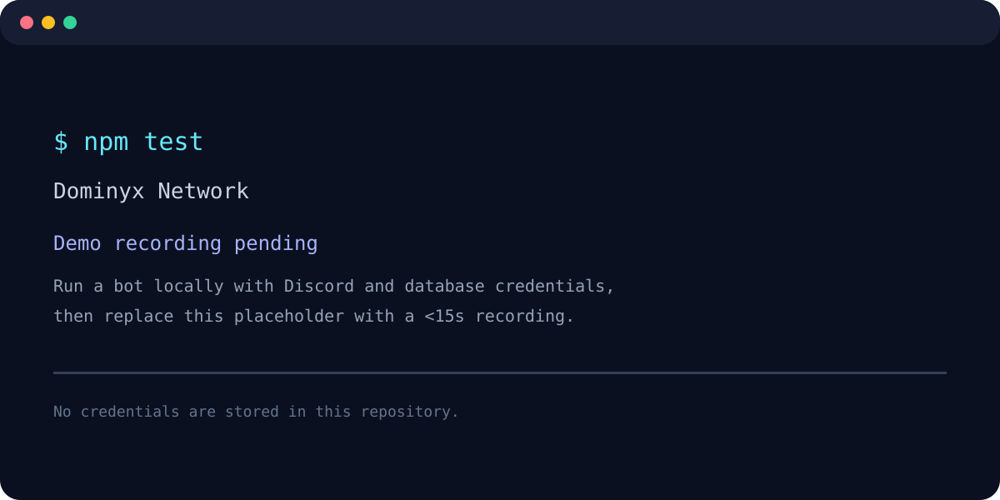

# Dominyx Network

[](https://github.com/Adityarajx11/Dominyx-Network/actions/workflows/ci.yml) [](./SECURITY.md)



A family of single-purpose Discord bots that share one Node.js core package.

**Live demo:** [Dominyx HQ](https://dominyx.vercel.app) · [Dashboard repository](https://github.com/Adityarajx11/dominyx-discord-bots)

## Quick start

```bash
npm install && npm test
```

Expected result: the core settings tests pass. Running a bot requires local Discord application credentials and a Postgres database; copy `.env.example`, fill the required values, then use the relevant `npm run start:<bot>` command.

## Features

| Package | Purpose | Start command |
| --- | --- | --- |
| `packages/music` | Lavalink music player with queues, playback controls, playlists, and 24/7 mode | `npm run start:music` |
| `packages/level` | XP, rank cards, leaderboards, level roles, and announcements | `npm run start:level` |
| `packages/greet` | Welcome cards, custom messages, and auto-roles | `npm run start:greet` |
| `packages/ticket` | Ticket panels, claim/priority controls, and transcripts | `npm run start:ticket` |
| `packages/ping` | YouTube live alerts | `npm run start:ping` |
| `packages/guard` | Moderation, case history, staff notes, bulk bans, and mod logs | `npm run start:guard` |
| `packages/hq` | Next.js dashboard for configuring the bot family | `npm run dev:hq` |

## Usage

Install slash commands once for each bot with the matching deploy command, for example:

```bash
npm run deploy:music
npm run start:music
```

Each bot needs `BOT_TOKEN`, `CLIENT_ID`, and `DATABASE_URL`. Music also needs the Lavalink settings. Ping needs `YOUTUBE_API_KEY` and `YOUTUBE_POLL_MINUTES`. See the guides in [`guide/`](./guide/) for deployment and recovery details.

## Configuration

Copy the root environment template for bot packages:

```bash
cp .env.example .env
```

The HQ dashboard has its own template at [`packages/hq/.env.example`](./packages/hq/.env.example). Never commit `.env`, `.env.local`, tokens, database credentials, or private keys.

## Repository layout

```text
packages/
  core/    shared command loader, deploy helpers, embeds, and Postgres pool
  music/   music bot
  level/   leveling bot
  greet/   greeting bot
  ticket/  ticket bot
  ping/    YouTube live-alert bot
  guard/   moderation bot
  hq/      Next.js dashboard
```

## Contributing

Read [`CONTRIBUTING.md`](./CONTRIBUTING.md) before opening a pull request. The project uses CommonJS, keeps shared logic in `@dominyx/core`, and expects tests for changes that affect core behavior.

## Security

Please follow [`SECURITY.md`](./SECURITY.md) for private vulnerability reporting. Do not post credentials in issues, discussions, logs, or pull requests.

## License

A project license is not yet selected. Choose a license before the first public release; the recommended default for this repository is MIT.
